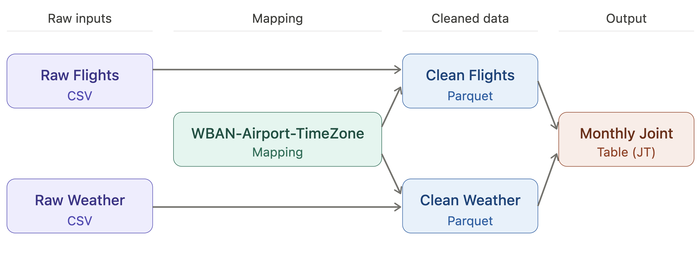

# Spark Flight–Weather Data Pipeline

[](https://github.com/Licheng1004/Spark-Flight-Delay-Pipeline/actions/workflows/ci.yml)

Transform raw flight and weather files into partitioned, flight-level tables for delay analysis. The project emphasizes data engineering: time zones, weather windows, cross-month boundaries, Parquet partitions and a downstream model check.

**Portfolio owner:** Licheng Xiong. **Context:** course project. **Stack:** Python, PySpark 3.5, Spark ML, Java 17, pandas, Parquet, GitHub Actions.

## Inspect the work



- [Final report](report/final_report.md) · [PDF report](report/final_report.pdf)
- [Flight/weather cleaning](notebooks/project_clean.ipynb)
- [Time-window joins](notebooks/project_join_test.ipynb)
- [Downstream Spark ML baseline](notebooks/JOIN_TOTAL_ML.ipynb)
- [Figure generation](notebooks/figures.ipynb)

## Project work and design

This repository publishes my course implementation, report and final notebooks, plus the environment and validation configuration. The original course data and referenced research belong to their authors; the implementation is not presented as an exact reproduction of the research paper.

1. Clean flight records, construct scheduled timestamps and account for time-zone differences.
2. Clean weather observations and map weather stations to airports.
3. Match departure/arrival weather from the preceding 0–12 hours; include neighboring months at boundaries.
4. Persist monthly Parquet partitions and build a wide joint table.
5. Fit a simple Random Forest baseline using 2012 training partitions and 2013 evaluation partitions.

## Reproduce the project

Install [uv](https://docs.astral.sh/uv/getting-started/installation/), then clone this repository. The committed `.python-version` selects Python 3.12.14; `pyproject.toml` and `uv.lock` lock the direct and transitive Python dependencies. First installation requires internet access.

```sh
git clone https://github.com/Licheng1004/Spark-Flight-Delay-Pipeline.git
cd Spark-Flight-Delay-Pipeline
uv sync --locked
uv run --locked python -m jupyterlab
```

**External prerequisite:** Java 17 must be installed and `JAVA_HOME` must point to it; `java -version` must work. The Python lock cannot install Java. Linux is the reference platform; on Windows, WSL2 is recommended for the full Parquet pipeline because Hadoop native utilities can be required. The CI workflow provisions Java 17 explicitly.

### Verify the installation and published evidence

```sh
uv run --locked python scripts/verify.py
uv run --locked python scripts/ci_smoke.py
```

`--locked` rejects stale project metadata instead of silently changing the dependency versions. Select `.venv` as the Jupyter kernel in VS Code. Notebook path detection supports execution from the repository root or a notebook subdirectory. Runtime installation and synthetic checks do not reproduce a private-data competition score.

See [the reproducibility record](REPRODUCIBILITY.md) for the actual checks performed, their scope and any external prerequisites.

## Data and full execution

Obtain the original [course dataset bundle](https://www.dropbox.com/sh/iasq7frk6f58ptq/AAAzSmk6cusSNfqYNYsnLGIXa), subject to access and use terms:

```text
data/raw/wban_airport_timezone.csv
data/raw/Flights/201201.csv
data/raw/Weather/201201hourly.txt
```

Include all required monthly files with original headers. Run cleaning first, then the joint-table notebook. Its checked-in `RUN_YEAR = 2013` and `RUN_MONTHS = [4, 6, 9, 11]` cover only the evaluation months. Run it again with **2012 / [1, 5, 7, 9]** before executing the downstream ML notebook, which needs both years. Keep neighboring weather-month inputs for buffered matches.

Finally run `JOIN_TOTAL_ML.ipynb` and, if desired, `figures.ipynb`. Generated Parquet files and figures under `outputs/` are ignored. Public checks start local Spark and validate a tiny DataFrame operation; they do not run the unavailable course dataset.

## Limitations and reuse

Only the selected months documented in the report were demonstrated. Wide weather matching, pivoting and output materialization dominate runtime; the small smoke check is not a benchmark of production scale. The downstream classifier checks the generated table's usability. Source access and Java/Hadoop requirements remain external to `uv.lock`; no new data redistribution or source-code reuse license is granted.
