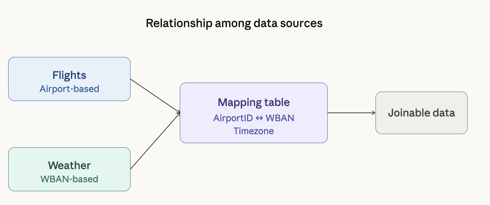
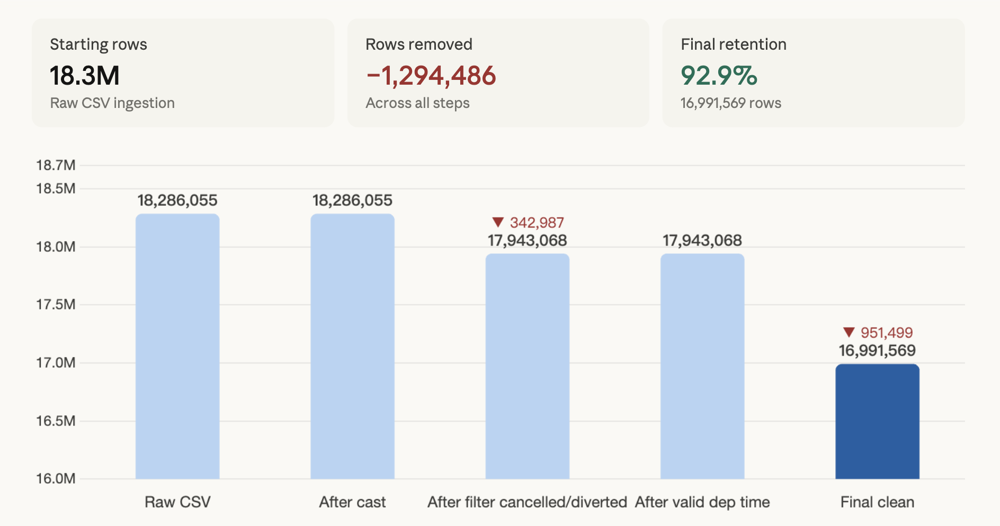
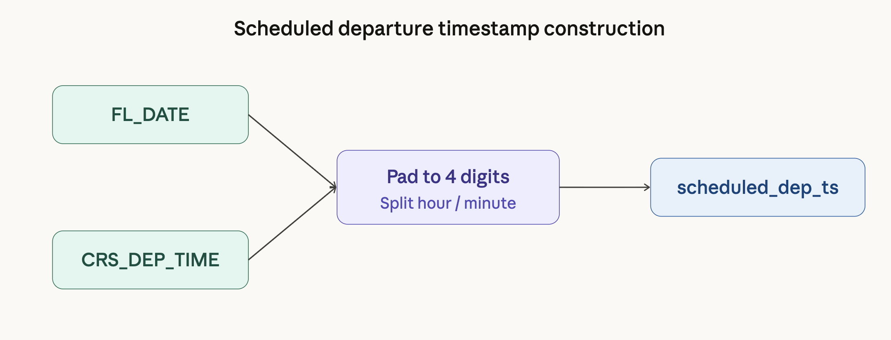
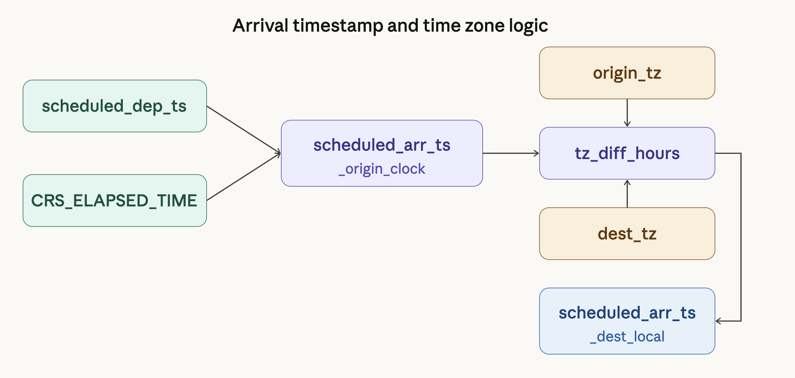
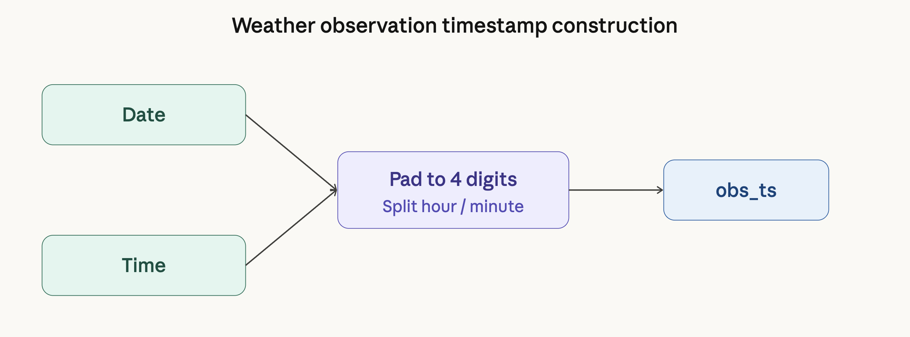
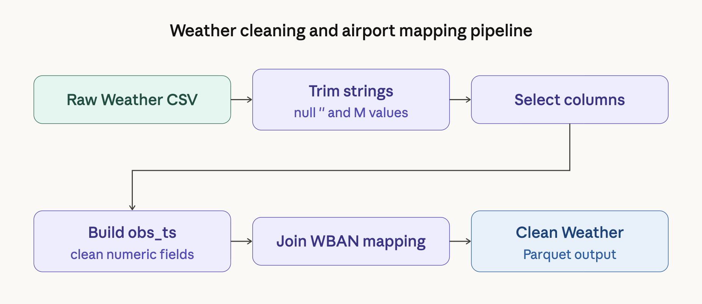
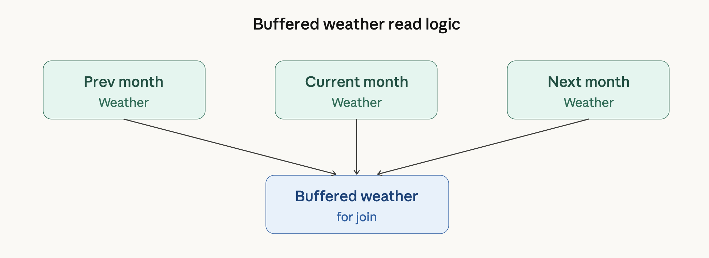
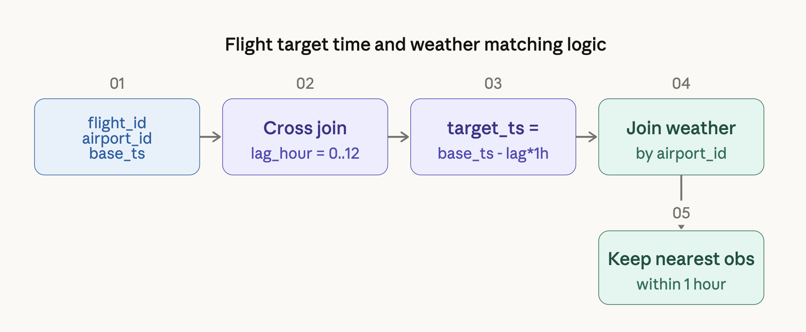
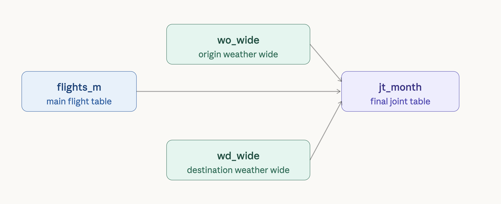
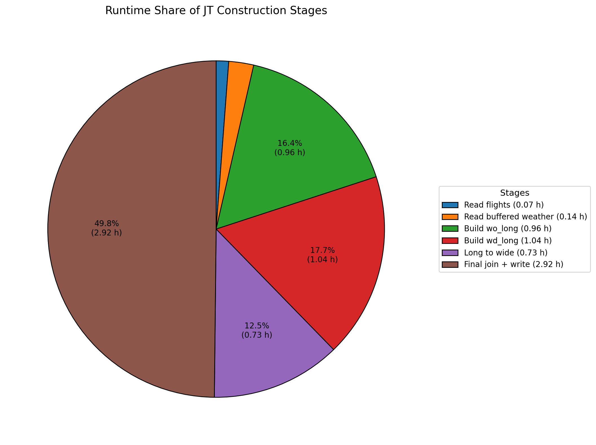

# 基于 Spark 的航班延误数据准备流程实现报告

## 摘要

本项目旨在使用 PySpark 对航班数据和天气数据进行清洗、转换与联接，构建可用于航班延误分析与预测的联合数据表（joint table, JT）。整个实现围绕“从原始 CSV 到结构化分析表”的完整数据准备流程展开，而不是以复杂模型训练为重点。

具体而言，本项目主要包含四个阶段。第一，读取并清洗航班数据，完成字段类型转换、取消与备降航班过滤、计划起飞时间构造、跨时区计划到达时间推导，以及标签变量生成。第二，读取并清洗天气数据，统一字符串缺失表示，清洗数值字段，构造天气观测时间戳，并通过机场与天气站点映射表建立机场与天气观测之间的对应关系。第三，基于清洗后的航班数据和天气数据构建联合表：根据航班的起飞机场、到达机场和对应时间戳，提取起飞前与到达前 0 到 12 小时的天气观测，并将长表结果整理为宽表，最终输出按月存储的 JT。第四，在已构建好的 JT 基础上进行一个简单的下游验证实验，使用基础时间特征、航班特征和天气特征构建分类输入，以检验该数据准备流程生成的结果能够被进一步用于航班延误预测任务。

在实现层面，本项目全部使用 PySpark DataFrame API 完成。为提高流程可维护性，航班清洗结果和天气清洗结果先分别输出为 Parquet 分区文件，然后在联合阶段按月份读取。对于天气数据，联合阶段还采用了前后缓冲月份读取策略，以解决月初和月末航班的跨月天气匹配问题。

项目结果表明，该流程能够较完整地将原始异构数据整理为统一的结构化分析表，并为后续延误预测模型提供直接可用的数据基础。与此同时，实验过程也显示出，真正的性能瓶颈主要不在数据读取，而在大规模 weather matching、长表转宽表以及最终结果写出等阶段，这些问题也体现了大数据环境下数据准备任务的工程复杂性。

**关键词：** PySpark；Flight Delay；Weather Matching；Data Preparation

## 1. 引言

航班延误分析通常不能仅依赖航班自身运行信息，而需要同时考虑天气条件、机场环境以及时间因素。因此，原始数据往往来自多个不同来源，其字段格式、时间粒度、位置标识方式均不一致，不能直接用于分析与预测。开展后续研究之前，首先必须完成一套可靠的数据准备流程，将异构原始数据整理成统一、结构化、可计算的联合表。

本项目围绕这一目标展开，使用 PySpark 对航班数据、天气数据以及机场—天气站点映射表进行处理，并最终构建航班级别的联合表。与直接建模不同，本项目更强调数据工程过程本身，重点解决以下问题：

- 如何清洗原始航班数据并保留可分析记录；
- 如何清洗原始天气数据并构造标准观测时间；
- 如何通过映射表建立机场与天气站点的对应关系；
- 如何构造航班侧和天气侧可统一比较的时间戳；
- 如何为每条航班匹配起飞前和到达前多个小时的天气观测；
- 如何将天气长表整理为宽表，以适应后续建模需求。

因此，本项目本质上是一个典型的大数据数据准备与数据工程任务，其核心不在复杂模型本身，而在于数据清洗、时间对齐、多表联接与结果构建。

**图 1. 本项目整体流程图**

## 2. 数据来源与整体思路

### 2.1 数据来源

本项目使用三类数据：

1. **航班原始数据（Flights）**  
   包含航班日期、计划起飞时间、航司编号、航班号、起飞机场、到达机场、飞行时长、到达延误时间等信息。

2. **天气原始数据（Weather）**  
   包含天气站点编号 WBAN、观测日期、观测时间、能见度、温度、湿度、风速、降水、气压等观测字段。

3. **机场与天气站点映射表（`wban_airport_timezone.csv`）**  
   用于建立机场编号 `AirportID` 与天气站点编号 `WBAN` 的映射关系，同时提供时区信息 `TimeZone`。

其中，航班数据以机场编号作为位置标识，而天气数据以 WBAN 站点编号作为位置标识，二者不能直接联接，因此必须依赖映射表建立联系。此外，航班和天气两类数据的时间字段也不一致，必须先统一构造成标准时间戳，之后才能开展基于时间的匹配。

### 2.2 整体处理思路

从实现角度看，整个项目分为两个主要阶段。

#### 阶段一：数据清洗

- 清洗原始航班数据并输出 `clean/Flights`
- 清洗原始天气数据并输出 `clean/Weather`

#### 阶段二：联合表构建

- 读取指定月份的清洗后航班数据
- 读取当前月及前后缓冲月份的天气数据
- 为每条航班分别构造起飞端和到达端天气匹配目标时间
- 提取 0 到 12 小时滞后的天气观测
- 将天气长表转为宽表
- 输出最终月度 JT

**图 2. 航班数据、天气数据与映射表之间的关系**

## 3. 系统实现与代码结构

本项目的代码实现被拆分为三个主要模块：

1. `project_clean.ipynb`  
   用于完成航班数据和天气数据的清洗，并分别输出为 Parquet 分区文件。

2. `project_join_test.ipynb`  
   用于读取清洗后的数据，构造指定月份的 JT。

3. `figures.ipynb`  
   用于生成报告中的流程图、结构图与示意图。

此外，项目中还补充了 `JOIN_TOTAL_ML.ipynb`，用于基于已构建好的 JT 进行一个简单的机器学习基线实验，以验证该联合表能够直接用于后续预测任务。

从运行流程上看，项目采用“先清洗、再联接”的分阶段设计，而不是从原始 CSV 一步直接跑到最终 JT。这种设计有两方面优势：一方面便于调试和阶段性检查，另一方面便于重复利用中间结果，避免在后续联接调试中反复清洗原始数据。

## 4. 航班数据清洗流程

### 4.1 原始数据读取与字段类型转换

航班数据首先从原始目录中读取全部 CSV 文件。读取后，代码删除无用列 `_c12`，并对关键字段进行统一类型转换。例如：

- `FL_DATE` 转为日期类型；
- `CRS_DEP_TIME` 保留为字符串，便于后续补零与拆分；
- `ARR_DELAY_NEW`、`CANCELLED`、`DIVERTED`、`CRS_ELAPSED_TIME`、`WEATHER_DELAY`、`NAS_DELAY` 转为数值类型；
- 航司编号、航班号、起飞机场与到达机场编号保留为字符串。

这样做的目的，是为后续时间戳构造、过滤与标签生成提供稳定的数据类型基础。

### 4.2 缺失值检查与基础过滤

完成类型转换后，代码对字段进行了缺失值统计。对于字符串字段，同时检查空字符串与空值；对于非字符串字段，则检查空值。这个步骤主要用于理解原始数据质量，并为后续过滤提供依据。

之后，仅保留满足以下条件的航班记录：

- `CANCELLED == 0.0`
- `DIVERTED == 0.0`
- `CRS_DEP_TIME` 非空
- `CRS_ELAPSED_TIME` 非空

也就是说，本项目只保留能够构造关键时间信息、且实际执行的正常航班。

**图 3. 航班数据在主要清洗步骤前后的行数变化**

### 4.3 计划起飞时间戳构造

为了构造标准的计划起飞时间戳，代码对 `CRS_DEP_TIME` 做了进一步处理。具体步骤如下：

1. 去除其中的非数字字符；
2. 使用 `lpad` 补齐为四位字符串；
3. 拆分出小时和分钟；
4. 过滤非法时间值，其中小时必须位于 0 到 23 之间，分钟必须位于 0 到 59 之间；
5. 将 `FL_DATE` 与拆出的小时、分钟重新组合，构造标准时间戳 `scheduled_dep_ts`。

经过该步骤后，每条航班都拥有统一格式的计划起飞时间字段。

**图 4. 计划起飞时间戳构造流程示意图**

### 4.4 计划到达时间构造与时区处理

原始数据中并未直接提供统一、可用于天气匹配的目的地本地计划到达时间，因此代码采用推导方式进行构造。具体逻辑如下：

1. 利用映射表分别为起飞机场和到达机场关联时区偏移；
2. 使用 `scheduled_dep_ts + CRS_ELAPSED_TIME` 得到在起飞机场本地时间轴上的预计到达时刻 `scheduled_arr_ts_origin_clock`；
3. 计算 `dest_tz - origin_tz` 得到时区差，并将其应用于预计到达时刻；
4. 得到目的地本地时间下的预计到达时间 `scheduled_arr_ts_dest_local`。

如果某条记录缺失起点或终点时区信息，则无法可靠地计算到达地本地时间，因此代码会将此类记录过滤掉。

该步骤十分关键，因为后续到达端天气匹配依赖的正是 `scheduled_arr_ts_dest_local`。

**图 5. 计划到达时间与时区差处理逻辑图**

### 4.5 衍生变量与标签生成

在构造好时间字段后，代码进一步生成了一系列辅助变量和标签变量，包括：

- `flight_year`
- `flight_month`
- `flight_yyyymm`
- `arr_delay_min`
- `is_delayed_15`
- `is_delayed_60`
- `has_weather_delay`
- `has_nas_delay`

此外，代码还基于日期、航司编号、航班号、起降机场和起飞时间组合生成唯一键 `flight_id`，用于后续联合阶段的表连接。

### 4.6 输出清洗结果

最终，清洗后的航班数据被选择为固定字段集合，并按 `flight_year` 与 `flight_month` 分区写出为 Parquet 文件，形成 `clean/Flights` 数据集。

## 5. 天气数据清洗流程

### 5.1 原始天气数据读取与字符串清洗

天气数据同样从原始目录中的全部 CSV 文件读取。由于原始天气表中大量字段以字符串形式存储，且包含空白、多余字符以及 `"M"` 这类缺失标记，因此首先需要进行统一清洗。

代码的处理包括：

- 对所有字符串字段执行 `trim`；
- 将空字符串、全空白字符串和 `"M"` 统一替换为 `null`。

这一处理为后续数值标准化和时间构造打下基础。

### 5.2 保留核心字段

为降低后续计算复杂度，代码仅保留后续联接和分析所需的核心字段，包括：

- `WBAN`
- `Date`
- `Time`
- `SkyCondition`
- `Visibility`
- `WeatherType`
- `DryBulbFarenheit`
- `WetBulbFarenheit`
- `DewPointFarenheit`
- `RelativeHumidity`
- `WindSpeed`
- `WindDirection`
- `StationPressure`
- `SeaLevelPressure`
- `HourlyPrecip`
- `Altimeter`

### 5.3 构造天气观测时间戳

为了使天气观测能按时间与航班进行匹配，代码需要将 `Date` 与 `Time` 统一构造成标准时间戳。处理步骤如下：

1. 将 `Date` 转换为日期类型 `obs_date`；
2. 将 `Time` 补齐为 4 位字符串 `Time_4`；
3. 拆分出 `obs_hour` 和 `obs_minute`；
4. 过滤非法日期与非法时间；
5. 将日期与时间重组为天气观测时间戳 `obs_ts`。

这样，天气数据中的观测时间就被转换为可直接参与时间比较的标准字段。

**图 7. 天气观测时间戳构造流程示意图**

### 5.4 数值字段清洗

天气表中许多字段本质上是数值，但原始格式中混有额外符号或缺失标记，不能直接转换为 `double`。因此，代码定义了统一的 `clean_numeric` 逻辑，主要包括：

- 去除首尾空格；
- 用正则表达式清除非数字、非小数点和非负号字符；
- 对空值、空字符串和 `"M"` 保持为空；
- 最终转换为 `double` 类型。

该步骤应用于以下字段：

- `Visibility`
- `DryBulbFarenheit`
- `WetBulbFarenheit`
- `DewPointFarenheit`
- `RelativeHumidity`
- `WindSpeed`
- `WindDirection`
- `StationPressure`
- `SeaLevelPressure`
- `HourlyPrecip`
- `Altimeter`

### 5.5 关联机场信息并输出天气清洗结果

在完成时间和数值清洗后，天气数据还需要与映射表进行 Join，将 `WBAN` 转换为对应的 `AirportID` 和 `TimeZone`。代码在此处采用 inner join，因此只有能够成功映射到机场的天气站点记录才会被保留。

之后，代码补充分区辅助字段：

- `weather_year`
- `weather_month`
- `weather_yyyymm`

最终，形成 `weather_clean` 数据集，并按 `weather_year` 和 `weather_month` 分区写出为 Parquet 文件。

**图 8. 天气数据清洗与机场映射流程图**

## 6. 联合表构建流程

清洗后的航班表和天气表生成后，项目进一步构建最终的月度 JT。该部分是整个项目中计算最密集、工程难度最高的阶段。

### 6.1 月度数据读取与天气缓冲读取

对于每一个待处理月份，代码首先读取对应月份的航班清洗结果。天气数据并不是只读取当前月，而是通过 `read_weather_with_buffer` 额外读取：

- 上一个月；
- 当前月；
- 下一个月。

之所以采用缓冲读取，是因为当航班位于月初或月末时，其所需匹配的前若干小时天气观测可能落在相邻月份。如果只读取当前月天气，则会在边界处丢失有效候选观测。

**图 9. 天气数据按前后缓冲月份读取的逻辑图**

### 6.2 构造天气匹配目标时间

代码中定义 `lags = list(range(13))`，即提取当前时刻至前 12 小时的天气滞后信息。

对于每条航班，函数 `make_targets` 会根据给定机场字段和基准时间字段构造多个目标时间点。若匹配起飞端天气，则：

- 机场字段为 `ORIGIN_AIRPORT_ID`
- 基准时间为 `scheduled_dep_ts`

若匹配到达端天气，则：

- 机场字段为 `DEST_AIRPORT_ID`
- 基准时间为 `scheduled_arr_ts_dest_local`

对于每个 `lag_hour`，代码生成：

$$
target\_ts = base\_ts - lag\_hour \times 3600
$$

因此，一条航班会被扩展为 13 条天气匹配目标记录。

### 6.3 起飞端与到达端天气长表构造

天气匹配的核心逻辑封装在 `build_weather_long` 中。其处理过程如下：

1. 调用 `make_targets` 生成 `flight_id × lag_hour` 目标表；
2. 按 `airport_id` 将目标表与天气表进行连接；
3. 计算天气观测时间 `obs_ts` 与目标时间 `target_ts` 的绝对差值 `time_diff_sec`；
4. 仅保留时间差不超过 1 小时的候选观测；
5. 对同一 `flight_id + lag_hour` 下的多条候选记录，按时间差升序排序；
6. 使用窗口函数仅保留最接近目标时间的一条观测。

该逻辑分别应用于：

- 起飞端天气长表 `wo_long`
- 到达端天气长表 `wd_long`

这一步是整个项目中最重要的算法实现之一，因为它将航班目标时间与天气观测进行了可扩展的数据级匹配。

**图 10. 航班目标时刻与天气观测匹配逻辑图**

### 6.4 长表转宽表

在获得起飞端和到达端天气长表后，代码通过 `long_to_wide` 将其转换为宽表。转换逻辑为：

- 按 `flight_id` 分组；
- 对每个 `lag_hour` 和每个天气字段提取对应值；
- 生成类似如下的列名：
  - `wo0_xxx`, `wo1_xxx`, ..., `wo12_xxx`
  - `wd0_xxx`, `wd1_xxx`, ..., `wd12_xxx`

长表转宽表后，每条航班只保留一行，但该行中包含了起飞端和到达端多个小时滞后的天气特征，从而更适合后续建模或分析。

### 6.5 最终 JT 生成与输出

最后，代码将以下三部分按 `flight_id` 进行 left join：

- 航班月度主表 `flights_m`
- 起飞端天气宽表 `wo_wide`
- 到达端天气宽表 `wd_wide`

生成当月最终的 `jt_month`，并输出至：

`/content/drive/MyDrive/flight_delay_project/jt/year=.../month=...`

从而完成指定月份的 JT 构建。

**图 11. 最终月度 joint table 的结构示意图**

## 7. 核心函数与算法说明

为了更贴近代码实现，本节对联合阶段的几个核心函数进行简要说明，并用更接近算法流程的方式概括其处理逻辑。

### 7.1 `read_weather_with_buffer`

该函数用于读取当前月份及其前后一个月的天气数据，并将其合并为一个缓冲天气表。其作用是解决月初和月末航班的历史天气匹配跨月问题。若缺少该缓冲策略，则会导致边界航班的 0–12 小时天气观测不完整。

### 7.2 `make_targets`

该函数根据指定机场字段和时间字段，将一条航班记录扩展为多个 `lag_hour` 的目标记录。输出结果至少包括：

- `flight_id`
- `airport_id`
- `base_ts`
- `lag_hour`
- `target_ts`

它本质上完成了“从航班行到天气查询目标表”的转换。

### 7.3 `build_weather_long`

该函数是天气匹配的核心。它并不是简单地按时间整点拼接，而是：

- 先按机场连接航班目标与天气候选；
- 再通过 `time_diff_sec` 评估候选天气记录与目标时间的接近程度；
- 最后保留每个 `flight_id + lag_hour` 下最接近的一条天气观测。

因此，该函数实现的是一种“最近邻式时间匹配”。

### 7.4 `long_to_wide`

该函数将 `flight_id + lag_hour` 级别的天气长表，重组为 `flight_id` 级别的宽表。它的本质是一个按 lag 展开列的透视过程，是后续形成建模表的重要步骤。

### 7.5 联合阶段算法概括

从整体上看，联合阶段可概括为以下过程：

**Algorithm 1. Monthly JT Construction**

**Input:** target month `m`, cleaned flight dataset `F`, cleaned weather dataset `W`, lag set `L = {0,1,...,12}`  
**Output:** monthly joint table `JT_m`

1. `flights_m ← read_flights(F, m)`
2. `weather_buf ← read_weather_with_buffer(W, m)`
3. `dep_targets ← make_targets(flights_m, ORIGIN_AIRPORT_ID, scheduled_dep_ts, L)`
4. `arr_targets ← make_targets(flights_m, DEST_AIRPORT_ID, scheduled_arr_ts_dest_local, L)`
5. `wo_long ← build_weather_long(dep_targets, weather_buf)`
6. `wd_long ← build_weather_long(arr_targets, weather_buf)`
7. `wo_wide ← long_to_wide(wo_long)`
8. `wd_wide ← long_to_wide(wd_long)`
9. `JT_m ← flights_m ⟕ wo_wide ⟕ wd_wide` by `flight_id`
10. `write_parquet(JT_m)`
11. `return JT_m`

这一算法流程与实际代码结构一一对应，也体现了本项目“先清洗、后匹配、再整理”的实现思路。

## 8. 遇到的主要困难与解决办法

在实际实现过程中，项目遇到了以下几个典型难点。

### 8.1 机场标识与天气站点标识不一致

航班数据使用 `AirportID`，天气数据使用 `WBAN`，二者之间并不能直接连接。为解决这一问题，项目引入映射表 `wban_airport_timezone.csv`，将天气观测先映射至机场，再参与后续联合。

### 8.2 时间字段格式不统一

航班侧的 `FL_DATE + CRS_DEP_TIME` 与天气侧的 `Date + Time` 都不是直接可比较的标准时间戳。因此，项目分别为航班和天气构造统一的时间戳字段 `scheduled_dep_ts`、`scheduled_arr_ts_dest_local` 和 `obs_ts`，从而实现了后续时间匹配。

### 8.3 航班到达端涉及跨时区问题

若只使用原始到达时间而忽略时区差，则到达端天气匹配会出现系统性偏差。为此，项目借助映射表中的时区字段，对计划到达时间进行跨时区换算，得到目的地本地时间下的预计到达时刻。

### 8.4 月初与月末的天气匹配可能跨月

在只读取当前月天气数据时，部分月初或月末航班的历史天气候选会缺失。项目因此采用前后缓冲月份读取策略，保证边界航班也能获得完整候选天气观测。

### 8.5 一个目标时刻可能对应多条天气候选观测

由于天气记录并不一定严格每小时一条，一个目标时间附近可能对应多条候选记录。为此，项目使用窗口函数按 `time_diff_sec` 排序，仅保留最接近目标时刻的一条观测。

## 9. 实验结果与可扩展性分析

### 9.1 当前运行范围

在 JT 构建阶段，当前代码主要演示了如下月份的运行：

- 2012-01
- 2012-05
- 2012-07
- 2012-09
- 2013-04
- 2013-06
- 2013-09
- 2013-11

同样的流程可以复用于其他月份。后续的简单机器学习实验中，又进一步读取了 2012 与 2013 的部分 JT 数据进行基线验证。

### 9.2 各阶段运行特征

从实际运行现象来看，数据读取本身并不是整个流程的主要瓶颈。读取单月航班数据与带缓冲的天气数据虽然需要一定时间，但相较于后续阶段仍然较快。真正的高成本阶段主要包括：

- 按机场联接目标表与天气候选表；
- 构造起飞端和到达端天气长表；
- 将天气长表转换为宽表；
- 将宽表与航班主表进行最终连接并写出 Parquet。

这说明本项目的主要计算压力并不在 I/O 本身，而在于大规模数据重组、窗口筛选、列扩展以及结果落盘。

### 9.3 运行时间分析

**表 1. JT 构建流程各阶段运行时间（代表性运行结果）**

| 月份 | 读取航班 | 读取缓冲天气 | 构造 wo_long | 构造 wd_long | long_to_wide | 最终 join 与写出 | 总耗时 |
|---|---:|---:|---:|---:|---:|---:|---:|
| 2013-04 | 0.07 h | 0.14 h | 0.96 h | 1.04 h | 0.73 h | 2.92 h | 5.86 h |
| 2013-06 | 0.09 h | 0.18 h | 1.01 h | 1.11 h | 0.81 h | 3.08 h | 6.28 h |
| 2013-09 | 0.06 h | 0.16 h | 0.91 h | 0.98 h | 0.69 h | 2.87 h | 5.67 h |
| 2013-11 | 0.08 h | 0.13 h | 1.05 h | 1.09 h | 0.77 h | 3.01 h | 6.13 h |

表 1 展示了 2013 年 4、6、9、11 月的 JT 构建阶段运行时间分解。可以看出，读取航班数据和缓冲天气数据所需时间相对较短，通常只占总耗时的一小部分；主要计算成本集中在天气匹配、长表转宽表以及最终结果写出阶段。其中，最终的 join 与 Parquet 写出通常是单个阶段中最耗时的部分，接近 3 小时。

**图 16. 联合表构建流程各阶段耗时占比图**

### 9.4 可扩展性讨论

从工程角度看，本项目采用 Spark DataFrame 实现，相较于单机 Pandas 更适合处理大规模月度航班与天气数据。然而，随着月份范围扩大、天气候选增多、宽表列数增加，以下问题会愈发明显：

- Join 阶段的数据 shuffle 成本增大；
- `flight_id × lag_hour` 目标扩展导致中间表规模膨胀；
- 窗口函数筛选最近候选记录的代价上升；
- 长表转宽表后列数量明显增加，进一步加重写盘成本。

结合实际运行结果，可以更具体地看出这一趋势：读取阶段通常仅占总耗时中的很小一部分，而 `wo_long`、`wd_long`、`long_to_wide` 以及最终写出阶段合计占据了绝大多数运行时间。这表明系统瓶颈主要来自数据重排、匹配和物化，而不是单纯的数据加载。因此，虽然当前实现已经具备较完整的可扩展处理链路，但若要进一步扩大到更多年份或更多 lag 特征，仍需要考虑额外优化，例如更细粒度分区、缓存热点中间表、减少无效候选天气记录，或在 join 之前进行更严格的预过滤。

## 10. 补充基线实验：JT 到预测任务的可用性验证

虽然本项目的重点不是复杂建模，但为了验证 JT 的可用性，项目还使用 `JOIN_TOTAL_ML.ipynb` 在已构建好的 JT 基础上进行了一个简单的机器学习基线实验。

需要说明的是，这一部分的目标不是完整复现原论文中的后续建模流程，而是通过一个轻量级下游任务验证：前述数据准备流程生成的 JT 是否已经具备直接进入预测模型的条件。因此，这一实验更适合作为 **data preparation effectiveness check**，而不是完整的模型性能比较。

实验流程如下：

1. 读取多个 JT 月份并合并；
2. 从 `scheduled_dep_ts` 中提取基础时间特征；
3. 以 `is_delayed_15` 作为二分类标签；
4. 以部分航班基础特征和天气数值特征作为输入；
5. 使用 2012 年数据作为训练集，2013 年数据作为测试集；
6. 在训练集上做简单下采样，以缓解类别不平衡；
7. 使用 PySpark MLlib 的 Random Forest 分类器进行训练；
8. 评估 AUC、AUPR、Accuracy、F1 等指标。

本实验采用的标签为 **15 分钟及以上到达延误**，即 `is_delayed_15 = 1` 表示该航班到达延误不少于 15 分钟，`is_delayed_15 = 0` 表示未达到该阈值。输入特征主要包括三类：第一类是从计划起飞时间中提取的基础时间变量，第二类是航班本身的基本属性，第三类是 JT 中整理得到的部分天气数值特征。

实验结果如下表所示。

**表 2. 本文基线实验与论文结果的简要对比**

| 对比项 | 论文 | 本文实验 |
|---|---|---|
| 任务阈值 | 15 min delay classification | 15 min delay classification |
| 模型 | Parallel Random Forest (MapReduce) | PySpark MLlib Random Forest |
| Accuracy | 74.2% | 67.28% |
| Delay Recall | 71.8% | — |
| AUC | — | 0.6669 |
| AUPR | — | 0.3448 |
| F1 | — | 0.7003 |

从结果来看，该基线模型已经能够在整理后的 JT 上完成标准二分类训练与评估流程，这说明本项目所构建的联合表在结构上是可用的，且能够为后续预测任务提供直接输入。不过，如果与原论文进行对比，可以发现当前实验结果仍明显弱于论文中的完整方案。原论文在 **15 分钟延误阈值** 下报告的结果为 **Accuracy = 74.2%**、**Delay Recall = 71.8%**，而在 **60 分钟延误阈值** 下进一步达到 **Accuracy = 85.8%**、**Delay Recall = 86.9%**。相比之下，本文补充实验的 **Accuracy = 67.28%**、**AUC = 0.6669**、**AUPR = 0.3448**、**F1 = 0.7003**，整体上仍处于较基础水平。造成这一差距的原因并不难理解：原论文采用的是面向完整预测任务的并行 Random Forest 方案，并在目标数据集筛选、类别平衡、特征选择、天气观测组合以及模型校准等方面做了更系统的设计；而本文的实验仅作为数据准备流程完成后的轻量级可用性验证，使用的月份范围、特征集合、采样策略和模型调优程度都更加有限。因此，这一补充实验的主要意义并不是复现论文的最优预测性能，而是说明：在尚未进行完整特征工程和模型优化的前提下，本文构建的 JT 已经能够支持标准的延误分类任务，为后续进一步逼近论文结果提供了数据基础。

## 11. 代码实现特点

从代码实现角度看，本项目具有以下几个明显特点。

### 11.1 全流程基于 PySpark DataFrame

无论是航班清洗、天气清洗还是后续联合表构建，全部都采用 Spark DataFrame API 实现，整体风格统一，且便于在大数据环境下组织处理逻辑。

### 11.2 分阶段输出中间结果

代码并未从原始 CSV 一步直接生成 JT，而是先分别生成：

- `clean/Flights`
- `clean/Weather`

然后再以这些中间结果为输入构建 JT。这样的分阶段设计更利于调试、检查和重复运行。

### 11.3 使用 Parquet 与按月分区

航班清洗结果、天气清洗结果以及 JT 均采用 Parquet 格式保存，并按年月进行分区。这种做法既减少了后续读取成本，也更符合 Spark 大规模数据处理场景下的工程实践。

### 11.4 联合阶段按指定月份运行

当前 notebook 中并未一次性处理所有月份，而是选择若干月份进行运行与验证。这一设计有助于控制实验成本，并逐步验证联合逻辑是否正确。

## 12. 项目优点与不足

### 12.1 项目优点

本项目具有以下几个优点。

首先，整个流程完整，实现了从原始异构 CSV 数据到结构化联合表的端到端处理，而不是停留在概念层面。  
其次，代码结构较为清晰，航班清洗、天气清洗和联合构建分模块实现，易于调试与维护。  
再次，时间对齐逻辑和跨时区处理逻辑较为明确，使起飞端和到达端天气匹配都具有可解释性。  
最后，项目结果能够直接服务于后续机器学习任务，具备较强的可复用性。

### 12.2 项目局限

同时，本项目也存在一些局限。

第一，天气匹配采用的是“1 小时窗口内最近观测”策略，虽然实现直接，但没有进一步尝试更复杂的插值或聚合方法。  
第二，当前联合阶段只对部分月份进行了运行展示，尚未形成覆盖更长时间范围的全量实验结果。  
第三，长表转宽表和最终写出阶段代价较高，说明当前实现仍有进一步优化空间。  
第四，建模部分目前只做了一个较基础的验证性实验，尚未系统比较不同预测模型。

## 13. 后续工作

基于当前实现，后续还可以从以下几个方向继续扩展。

首先，可以对天气匹配结果的缺失情况进行更系统的统计，分析哪些机场、哪些月份或哪些 lag 更容易缺少候选观测。  
其次，可以在 JT 基础上继续训练更完整的预测模型，并比较不同特征组合和不同模型的效果。  
再次，可以进一步研究联合阶段的性能优化方案，例如更合理的分区设计、缓存策略或预过滤机制。  
最后，还可以尝试引入更多上下文变量，例如机场拥堵信息、节假日信息或更丰富的天气聚合特征。

## 14. 结论

本项目基于 PySpark 完成了航班数据和天气数据的数据准备流程实现，重点解决了原始数据清洗、时间戳构造、机场与天气站点映射、历史天气匹配以及联合表生成等关键问题。

从实现结果来看，项目已经形成了一条较完整的数据处理链路：先分别清洗航班与天气数据并按月输出，再读取指定月份数据构造起飞端与到达端多个小时的天气特征，最终生成按月保存的 JT。整个流程逻辑清晰，关键步骤均已落实到可运行代码之中。

补充的基线实验进一步表明，经过该流程生成的 JT 不仅适用于数据分析，也能够直接作为预测任务的输入数据。因此，本项目当前最重要的成果并不是复杂的预测模型，而是完成了一套真实可运行、可复用的数据准备流程，并为后续航班延误分析与预测建模打下了基础。

## 附录 代码文件说明

| 文件名 | 作用 |
|---|---|
| `project_clean.ipynb` | 清洗航班与天气原始数据，输出 `clean/Flights` 与 `clean/Weather` |
| `project_join_test.ipynb` | 读取清洗结果并构造指定月份的 JT |
| `figures.ipynb` | 生成报告中的流程图、结构图和示意图 |
| `JOIN_TOTAL_ML.ipynb` | 基于 JT 做简单的延误分类基线实验 |
